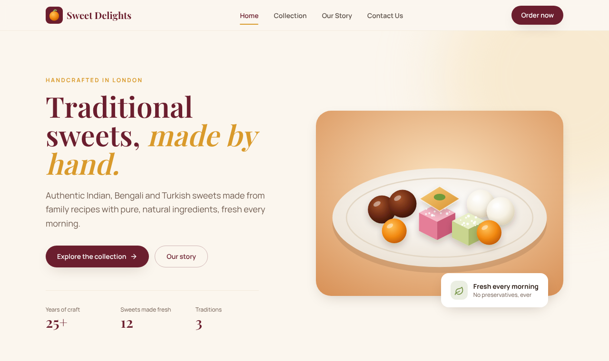

# Sweet Delights

A responsive multi-page website for **Sweet Delights**, a fictional shop selling handcrafted Indian, Bengali and Turkish sweets.



**Live site:** https://thenaeemprodhan.github.io/SweetDelights/

## Pages

| Page | What's on it |
|------|--------------|
| **Home** (`index.html`) | Hero section, why-choose-us features, best sellers, the three traditions, customer reviews |
| **Collection** (`collection.html`) | All 12 sweets with prices, filterable by Indian, Bengali or Turkish |
| **Our Story** (`story.html`) | The brand's history, an image slider and a timeline |
| **Contact Us** (`contact.html`) | Contact form with validation, address, phone, email and opening hours |

## Features

- **Responsive design** for phones, tablets and desktops, with a mobile menu
- **Product filter**: category buttons update the grid instantly, and a link such as `collection.html#bengali` opens that category
- **Data-driven products**: all sweets live in `js/products.js`, so you can edit one file and both pages update
- **"Order" links** open the contact form with the subject set to "Place an order" and the sweet's name in the message
- **Image slider** with arrows, dots, autoplay and swipe on touch screens
- **Form validation** with inline error messages and a confirmation screen
- **Accessibility**: semantic HTML, skip link, keyboard focus styles, ARIA labels, and reduced motion when the visitor's system asks for it
- **Custom 404 page** for GitHub Pages

## Built with

- **HTML5** and **JavaScript**, with no frameworks
- **[Tailwind CSS](https://tailwindcss.com/)**, compiled to a single small stylesheet
- **[Lucide](https://lucide.dev/)** icons, inlined as an SVG sprite
- **Google Fonts**: Playfair Display and Manrope
- Hand-made SVG illustrations of each sweet

## Run it locally

Download or clone the repository and open `index.html` in your browser. That's all you need, because the compiled CSS is already included.

```sh
git clone https://github.com/thenaeemprodhan/SweetDelights.git
cd SweetDelights
open index.html        # macOS. On Windows, double-click index.html
```

### Changing the styles

You only need Node.js if you change Tailwind classes or `src/input.css`:

```sh
npm install
npm run dev     # rebuilds css/style.css every time you save
npm run build   # one-off minified build
```

## Project structure

```text
├── index.html, collection.html, story.html, contact.html, 404.html
├── css/style.css          # compiled Tailwind output (don't edit by hand)
├── src/input.css          # Tailwind source and custom component classes
├── js/
│   ├── products.js        # the product catalogue
│   └── main.js            # menu, filters, slider, contact form
├── images/
│   ├── favicon.svg
│   └── sweets/            # one illustration per sweet
└── tailwind.config.js     # brand colours and fonts
```

## Notes

- Sweet Delights, its address, phone number and reviews are all fictional.
- The contact form works entirely in the browser and doesn't send messages anywhere. To receive real messages, connect it to a service such as [Formspree](https://formspree.io/) (see the comment in `js/main.js`).
